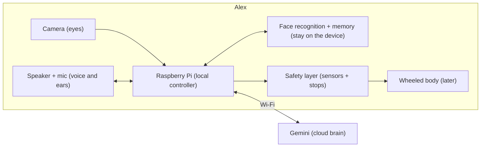

# AI Home Companion Robot
An AI home companion robot, built from scratch and powered by Google Gemini. Meet Alex (the kids call him Alexki).

**Status:** 🛠️ Working prototype · Sees, recognises faces, talks and remembers · Moving onto Raspberry Pi · Started October 2026
**Builder:** Ranjit

A small, friendly home robot that can see, listen, talk, and keep
the family company, with Google Gemini as its brain and a
Raspberry Pi as its body.

## The idea
Most home robots are closed products you can't change.
Alex is a custom AI system where I control every layer:
the AI model, what it can do, its safety rules, and how it
connects to other systems.

It's built on the same principle I use in AI automation:
**an AI agent whose tools happen to be motors.**

## What Alex can do today
- **Sees and recognises:** knows each family member by face and greets them by name
- **Talks:** natural voice conversation, with a warm, kid-friendly personality
- **Remembers:** keeps family facts, but only when someone asks him to
- **Meets new people:** asks a new face their name (visitors are never saved)
- **Safe for kids:** strict content rules, plus a diary parents can check
- **Easy to wake:** starts with one click

## What's coming next
- **His own body:** Raspberry Pi, camera eye, speaker and mic in a robot head
- **Live conversation:** fast, natural back-and-forth with Gemini Live
- **Routine helper:** knows the family schedule and gives gentle reminders
- **Helper (later):** wheels, follows you around and carries small items on a tray
- **Elder care (future):** daily check-ins, help alerts sent to family,
  and an offline warning if the robot stops responding

## How it works

Gemini makes the decisions. The robot handles safety locally,
so it stops itself if anything goes wrong, even without internet.
Family faces and memories stay on the device, not in the cloud.

## Roadmap
- [x] **Prototype:** sees, recognises the family, talks, remembers (on a laptop)
- [ ] **Phase 1, the head:** moves onto the Raspberry Pi, live conversation, routine helper
- [ ] **Phase 2, the body:** wheels, follows family members, carries items
- [ ] **Phase 3, elder care:** check-ins, help alerts, heartbeat monitoring

## Progress log

| Date | Milestone |
|---|---|
| Oct 8, 2026 | Idea explored, feasibility checked and blueprint created |
| Oct 12, 2026 | Concept and architecture registered on GitHub |
| Oct 16, 2026 | Robot named Alex ("Alexki") by my son 🦁 |
| Oct 19, 2026 | Alex sees and greets the family by name, with a natural voice 🎉 |
| Oct 19, 2026 | Alex listens and talks back by voice 🎤 |
| Oct 20, 2026 | Ronin had his first conversation with Alex 🦁 |
| Oct 23, 2026 | Alex remembers the conversation 🧠 |
| Oct 24, 2026 | Alex recognises the whole family by face 👀 |
| Oct 25, 2026 | Alex now has long-term memory 🧠 |
| Oct 26, 2026 | Alex sees, hears and talks in one go, and wakes up with one click 🖱️ |
| Oct 27, 2026 | Project renamed: AI Home Companion Robot |
| Oct 28, 2026 | Hatching started: Raspberry Pi 5 parts arrived and passed every test — Alex took his first photo through his own camera eye
| Oct 30, 2026 | Alex has a head: camera eye, mic nose and speaker mouth, all working from inside the head

---
*Detailed technical design kept private during development.*
