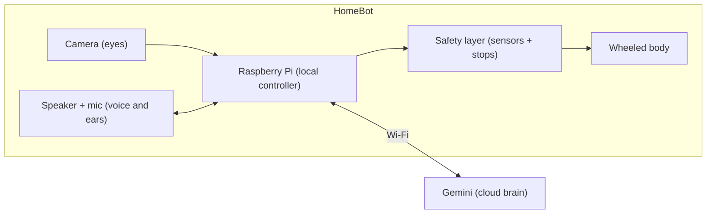

# Homebot
A home companion robot powered by Gemini, concept stage.
# HomeBot — A Home Companion Robot

**Status:** 💡 Concept stage · Development on hold · Concept registered October 2026
**Builder:** Ranjit

A small, friendly home robot that can see, listen, talk, and keep
the family company, with Google Gemini as its brain and a
Raspberry Pi as its body.

## The idea
Most home robots are closed products you can't change.
HomeBot is an open AI system where I control every layer:
the AI model, what it can do, its safety rules, and how it
connects to other systems.

It's built on the same principle I use in AI automation:
**an AI agent whose tools happen to be motors.**

## What it will do
- **Companion:** talks, plays, and keeps the family company, like a pet
- **Helper:** follows you around the home and carries small items on its tray
- **Family friendly:** recognises family members and greets them by name
- **Elder care (future):** daily check-ins, help alerts sent to family,
  and an offline warning if the robot stops responding

## How it works

Gemini makes the decisions. The robot handles safety locally,
so it stops itself if anything goes wrong, even without internet.

## Roadmap
- [ ] **Phase 1, the head:** sees, listens, talks, with a personality
- [ ] **Phase 2, the body:** wheels, follows family members, carries items
- [ ] **Phase 3, elder care:** check-ins, help alerts, heartbeat monitoring

## Progress log

| Date | Milestone |
|---|---|
| Oct 8, 2026 | Idea explored, feasibility checked and blueprint created |
| Oct 12, 2026 | Concept and architecture registered on GitHub |
| Oct 16, 2026 | Robot named Alex ("Alexki") by my son 🦁 |
| Oct 19, 2026 | Alex sees and greets the family by name, with a natural voice 🎉 |
| Oct 19, 2026 | Alex listens and talks back by voice 🎤 |
| Oct 20, 2026 | Ronin had his first conversation with Alex 🦁 |
| Oct 23, 2026 | Alex remembers the conversation 🧠 |
| Oct 24, 2026 | Alex recognises the whole family by face 👀 |

---
*Detailed technical design kept private during development.*
